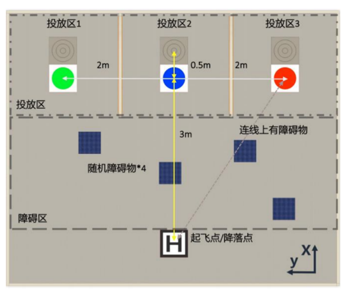
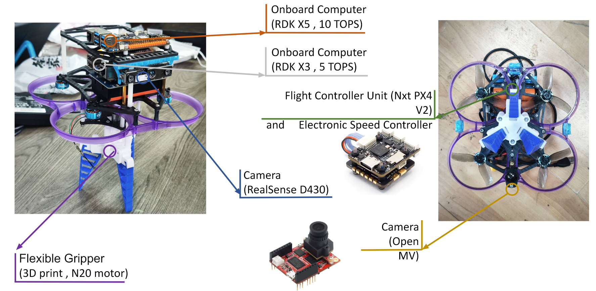
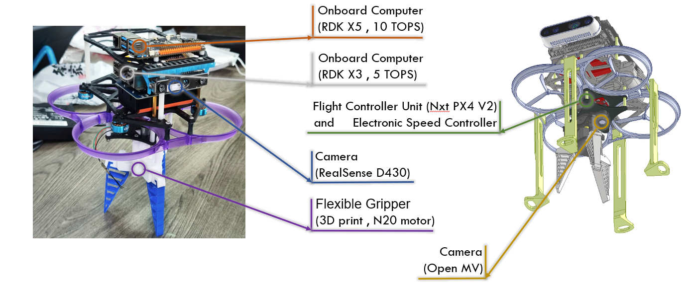
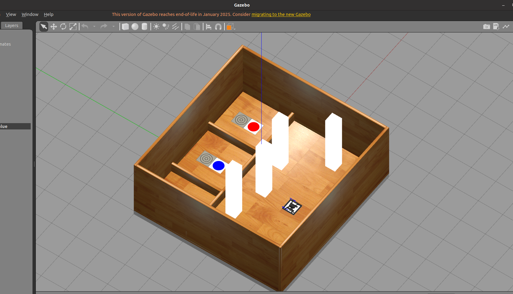

# 基于 RDK X5 的自主任务微型无人机

**睿抗机器人开发者大赛 · 省级三等奖 · 2025.01–2025.05**  
`Linux` `ROS` `VINS-Fusion` `EGO-Planner` `OpenCV` `PX4` `Gazebo`

这个项目中，我主要参与定位与轨迹规划集成、标靶视觉处理和飞行仿真联调。我们为室内比赛搭建了一台微型无人机，配有深度相机、机载计算平台、飞控和底部抓取机构。

## 1. 比赛任务

无人机需要携球起飞，导航至指定区域，途中避开障碍，识别目标颜色，再完成投放和降落。下面是赛题场地布局，包含投放区域、障碍区和起降标记。



*Fig. 1 比赛场地与任务区域示意图*

```text
携球起飞 → 导航与避障 → 识别指定颜色 → 抓取/投放 → 降落
```

## 2. 整机结构



*Fig. 2 无人机硬件结构与实物部件标注图*

机载平台运行感知和任务处理程序，PX4 负责底层飞行控制。RealSense 提供图像和深度数据，OpenMV 用于标靶视觉实验。抓取机构安装在机身底部，用于携球、抓取和投放。



*Fig. 3 无人机实物与 CAD 结构对照图*

整机建模和装配由团队完成，我主要做感知、软件集成和仿真。[硬件结构记录](docs/hardware.md) 中还有 CAD 模型和实物照片。

## 3. 自主导航框架与系统架构

导航系统分为传感器、定位与建图、运动规划和控制器四部分。机载电脑运行感知和规划程序，飞控负责底层控制。


*Fig. 4 通用自主导航框架思维图*

我们的项目采用 VINS-Fusion 和 EGO-Planner，分别完成位姿估计与局部轨迹规划。


*Fig. 5 无人机系统架构与数据流图*

图像和 IMU 数据送入定位模块，深度图提供障碍物信息。规划模块根据当前位姿、环境和目标生成轨迹，通过 ROS/MAVROS 与 PX4 通信。我在 ROS 下集成定位、规划和飞控模块，并进行联调，具体记录见 [系统架构](docs/architecture.md)。

## 4. 定位与建图


*Fig. 6 视觉惯性定位与环境感知方案图*

定位部分我用的是 [VINS-Fusion](https://github.com/HKUST-Aerial-Robotics/VINS-Fusion)。我在 ROS 下完成模块集成，并参与 RealSense 相机与 IMU 的标定和数据融合。VINS-Fusion 输出无人机的位置与姿态，供轨迹规划使用。

障碍物信息来自深度图。在系统设计中，深度图经过处理后生成环境地图，再和位姿一起送入规划模块。这两部分数据需要对齐时间戳和坐标系，避免地图中的障碍物与无人机的位置对应不上。

## 5. 规划与控制


*Fig. 7 路径搜索与轨迹曲线原理示意图*

我用 [EGO-Planner](https://github.com/ZJU-FAST-Lab/ego-planner) 做局部轨迹规划，并联调定位、规划和飞控模块，开展导航与局部避障测试。规划模块根据当前位姿、障碍物和目标位置生成轨迹，PX4 负责底层姿态和电机控制。

上面的 A* 搜索和贝塞尔曲线是规划原理示意，项目实际使用的规划器是 EGO-Planner。

## 6. 标靶识别与位置偏移


*Fig. 8 标靶颜色识别与位置偏移处理流程图*

我用 OpenCV 做红、绿、蓝三色标靶检测，提取标靶中心，计算它与图像中心的偏移。流程图采用霍夫圆变换方案，保留的桌面实验脚本使用轮廓和最小外接圆，两种处理方式见 [视觉处理记录](docs/vision.md)。


*Fig. 9 红、绿、蓝三色标靶识别演示*

处理画面中标出了轮廓、圆心和偏移量。连线连接标靶圆心与图像中心，`dx`、`dy` 分别表示水平和垂直方向的像素偏移。将这些结果用于投放或导航，还需要结合深度数据和坐标变换。

完整视频：[红色标靶](media/target-red.mp4) · [绿色标靶](media/target-green.mp4) · [蓝色标靶](media/target-blue.mp4)，每段约 6 秒。

## 7. 飞行仿真



*Fig. 10 Gazebo 比赛仿真场景*

我们在 Gazebo 中搭建了比赛场景，放置障碍物、彩色标靶和降落标记。我在这个场景中做飞行仿真联调，测试导航和局部避障，并通过 RViz 查看环境地图与轨迹。


*Fig. 11 Gazebo 与 RViz 飞行仿真演示*

左侧是 Gazebo 中的无人机运动，右侧是 RViz 中的环境地图与轨迹。完整视频：[Gazebo，约 13 秒](media/gazebo-navigation.mp4) · [RViz，约 13 秒](media/rviz-navigation.mp4)。


*Fig. 12 无人机仿真联调全景演示*

这段联调视频同时记录了仿真、可视化和飞控界面。[查看完整联调视频，约 17 秒](media/gazebo-integration.mp4)。

仿真环境采用 ROS、PX4、MAVROS/MAVLink 和 XTDrone。我们完成了环境配置和键盘起降，并在 Gazebo 与 RViz 中进行模块联调。

## 我的工作与项目成果

我的主要工作是 Linux/ROS 下的定位与规划集成、OpenCV 标靶中心提取、参与相机/IMU 标定，以及 Gazebo 飞行仿真联调。整机结构、机械设计与装配属于团队成果，定位、规划和飞控的基础能力来自相应开源组件。

我们完成了无人机建模与实物搭建、比赛仿真场景搭建、三色标靶检测和飞行仿真联调，并获得竞赛省级三等奖。

## 项目细节

- [系统架构](docs/architecture.md)：传感器、定位、规划与飞控的数据关系。
- [视觉处理](docs/vision.md)：颜色分割、圆心提取、偏移量和接口。
- [硬件结构](docs/hardware.md)：模型、实物与组件分工。
- [演示说明](docs/demo-guide.md)：原始视频和 GIF 预览。
- [软件与运行环境](docs/implementation-and-environment.md)：开源组件、运行环境与工程文件。
- [素材与开源项目](docs/sources.md)：项目图片、视频的来源和开源项目链接。
