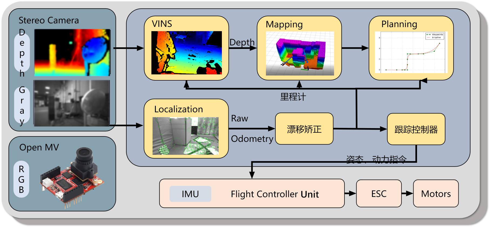
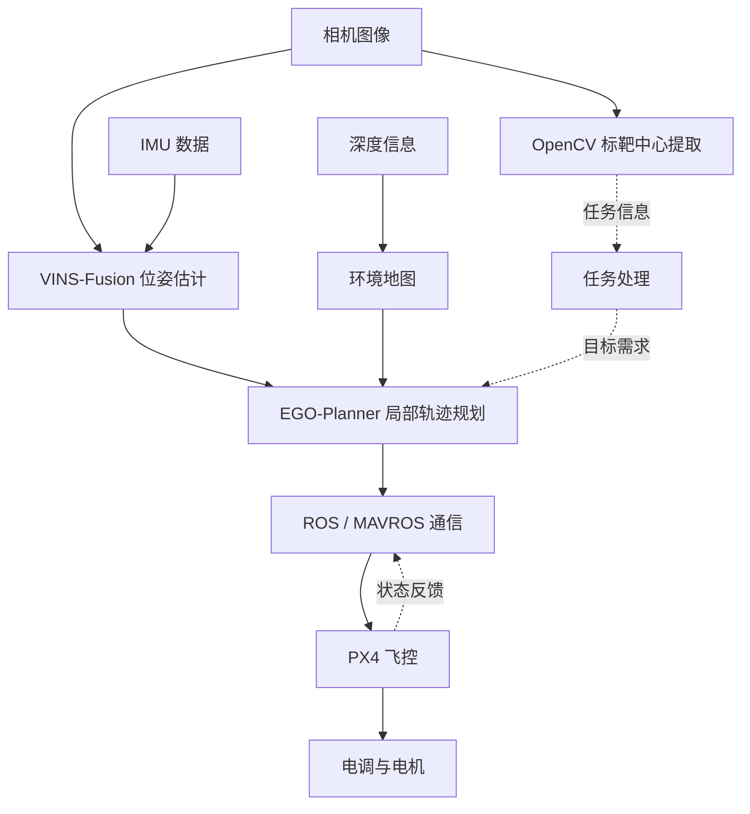
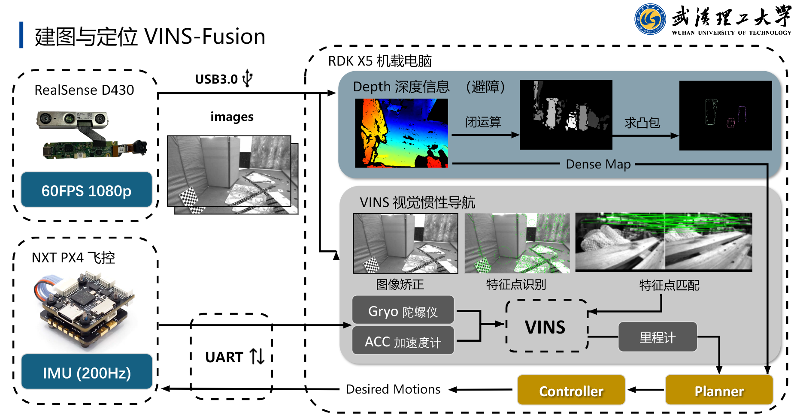
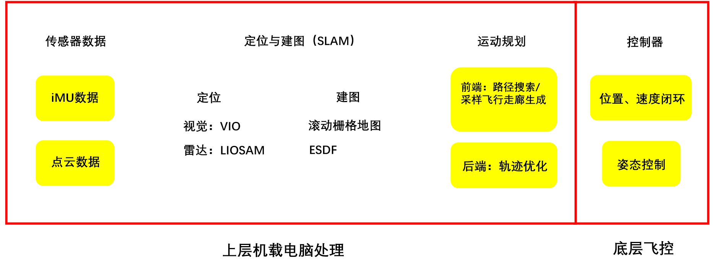
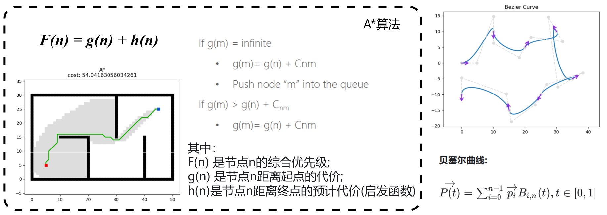

# 系统架构与数据流

我在 ROS 下集成定位、规划和飞控模块。机载平台运行感知与规划程序，PX4 负责底层飞行控制，两者通过 ROS/MAVROS 传递状态和指令。

*Fig. 1 无人机系统架构与数据流图*

## 模块之间的数据关系

*Fig. 2 定位、规划、视觉与飞控的模块连接方案*

图像和 IMU 数据用于位姿估计，深度图用于获取障碍物信息。标靶检测输出目标中心，任务处理模块据此确定目标需求，再由规划模块生成轨迹。

## 定位与环境地图

*Fig. 3 视觉惯性定位与环境感知方案图*

定位部分我使用 [VINS-Fusion](https://github.com/HKUST-Aerial-Robotics/VINS-Fusion)，并参与相机与 IMU 的标定和数据融合。它输出无人机的位置与姿态，供规划模块使用。

深度图走另一条处理流程。系统设计采用闭运算和凸包处理深度信息，形成环境地图后送入规划模块。定位结果与地图需要使用一致的时间戳和坐标系。

## 规划与飞控通信

我集成 [EGO-Planner](https://github.com/ZJU-FAST-Lab/ego-planner) 做局部轨迹规划，并联调定位、规划和飞控模块。机载系统通过 [MAVROS](https://github.com/mavlink/mavros) 与 PX4 通信，PX4 负责底层姿态和电机控制。

| 模块连接 | 接口要求 |
| --- | --- |
| 传感器 → 定位 | 图像与 IMU 时间同步，外参正确，输入频率与配置匹配 |
| 定位 → 规划 | 坐标系一致，位姿更新连续 |
| 环境地图 → 规划 | 深度数据、地图与位姿使用同一坐标系 |
| 规划 → 飞控 | 控制输入的单位、坐标约定与状态反馈一致 |

## 导航框架与规划原理

*Fig. 4 通用自主导航框架思维图*

通用导航框架包含视觉、雷达以及不同地图表示方法。我们的项目采用 VINS-Fusion 与 EGO-Planner；图中的 LIOSAM 和 ESDF 是其他导航路线。

*Fig. 5 路径搜索与轨迹曲线原理示意图*

A* 用启发式搜索寻找绕开障碍物的路径，曲线用于表示连续轨迹。这里的 A* 与贝塞尔曲线是原理示例，项目实际使用的规划器是 EGO-Planner。

## 标靶检测与任务处理

我用 OpenCV 提取标靶中心和图像偏移。检测结果属于图像坐标，将它用于导航或投放时，还需要深度数据和坐标变换。

红色检测节点包含图像订阅、检测开关、阈值切换和中心坐标发布，接口见 [视觉处理](vision.md)。

## 仿真联调

我在 Gazebo 中测试导航和局部避障，通过 RViz 查看环境地图与轨迹。仿真环境采用 ROS、PX4、MAVROS/MAVLink 和 XTDrone，团队完成了环境配置和键盘起降。[演示视频](demo-guide.md) 中保留了场景飞行、轨迹可视化和联调过程。
