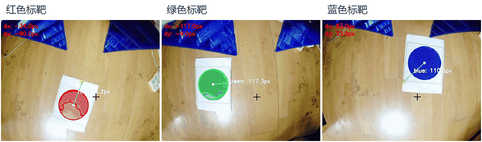
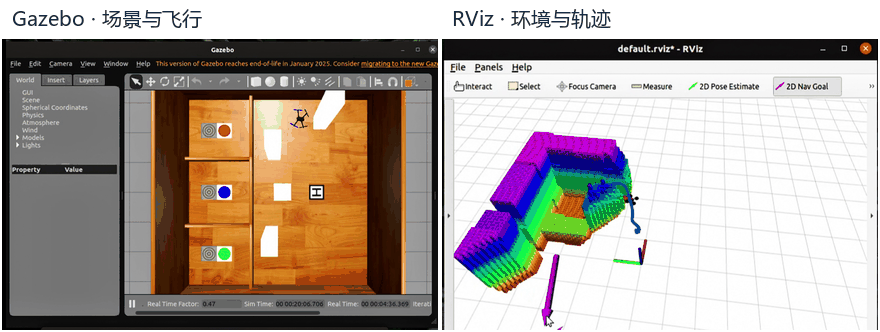
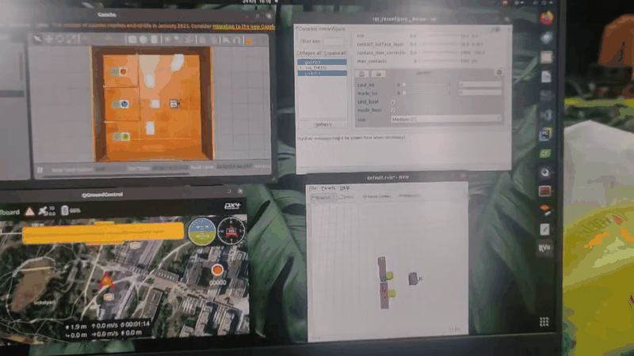

# 项目演示

## 彩色标靶检测

*Fig. 1 红、绿、蓝三色标靶识别演示*

| 视频 | 内容 | 时长 |
| --- | --- | --- |
| [红色标靶](../media/target-red.mp4) | 轮廓、圆心和偏移标注 | 5.9 秒 |
| [绿色标靶](../media/target-green.mp4) | 轮廓、圆心和偏移标注 | 5.9 秒 |
| [蓝色标靶](../media/target-blue.mp4) | 轮廓、圆心和偏移标注 | 5.9 秒 |

画面中的圆心、连线和 `dx/dy` 表示标靶在图像中的位置与偏移，单位是像素。坐标约定与输出接口见 [视觉处理](vision.md)。

## Gazebo 与 RViz 飞行仿真

*Fig. 2 Gazebo 与 RViz 飞行仿真演示*

左侧是 Gazebo 中的场景和无人机运动，右侧是 RViz 中的环境地图和轨迹。两个面板分别来自独立视频。

| 视频 | 内容 | 时长 |
| --- | --- | --- |
| [Gazebo 场景飞行](../media/gazebo-navigation.mp4) | 彩色标靶、障碍物和无人机运动 | 12.7 秒 |
| [RViz 环境与轨迹](../media/rviz-navigation.mp4) | 环境地图与轨迹可视化 | 12.7 秒 |

## 仿真联调

*Fig. 3 无人机仿真联调全景演示*

这段视频记录了 Gazebo、RViz 和飞控相关界面。[完整联调视频，约 16.93 秒](../media/gazebo-integration.mp4)。

仿真环境采用 XTDrone、ROS、PX4 和 Gazebo，团队完成了环境配置和键盘控制起降，我参与导航与局部避障仿真联调。

## 视频与 GIF

MP4 保留原始视频，GIF 从对应视频抽帧、缩小并排版。

| GIF | 视频片段 | 播放时长 |
| --- | --- | --- |
| 三色标靶 | 每段第 0–5.8 秒 | 5.8 秒 |
| Gazebo/RViz | 每段第 1–9 秒 | 8 秒 |
| 联调全景 | 第 2–10 秒 | 8 秒 |

GIF 使用 5 fps 预览，视频帧率与算法处理速度是不同的指标。
