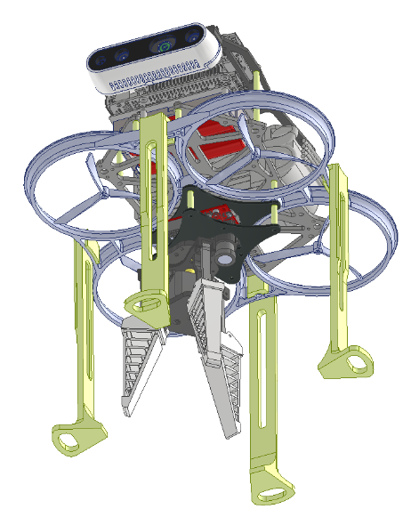
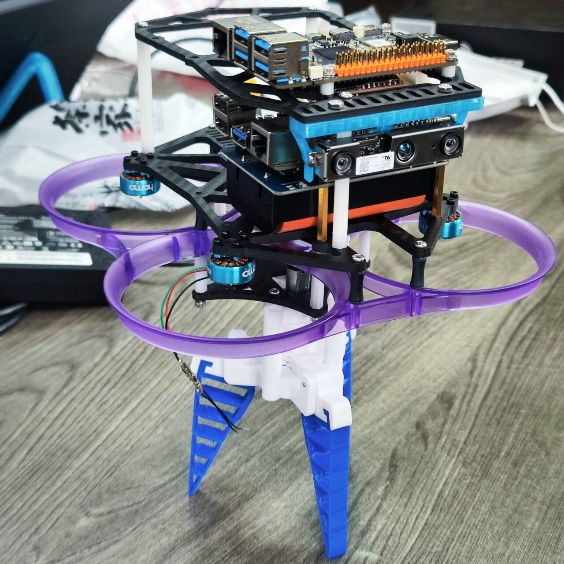

# 无人机硬件结构

整机建模和装配由团队完成，我主要做感知、软件集成和仿真。无人机采用上下分层结构，机载平台位于上层，抓取机构安装在底部。

*Fig. 1 无人机 CAD 结构模型*

*Fig. 2 无人机实物原型*

## 部件位置

*Fig. 3 无人机硬件结构与实物部件标注图*

RealSense 相机获取环境图像和深度数据，底部的 OpenMV 用于标靶视觉实验。抓取机构采用 3D 打印结构和 N20 电机，用于携球、抓取与投放。

*Fig. 4 无人机实物与 CAD 结构对照图*

## 组件分工

| 组件 | 用途 |
| --- | --- |
| 机载计算平台 | 运行感知、定位、规划和任务处理程序 |
| RealSense 深度相机 | 提供图像和深度数据 |
| PX4 飞控与电调 | 底层飞行控制与电机驱动 |
| OpenMV | 标靶视觉实验 |
| 抓取机构 | 携球、抓取与投放 |
| 保护结构 | 围绕机身与旋翼布置 |

## 硬件配置

项目名称采用 RDK X5，结构图同时标注了 RDK X3 与 RDK X5。相机在不同资料中出现 D430 和 D430i 两种型号，最终板卡分工、相机型号及 IMU 来源以硬件清单和标定配置为准。

图中的 TOPS 是板卡规格，FPS 与 IMU 频率是方案配置标注，不是整机测试结果。
