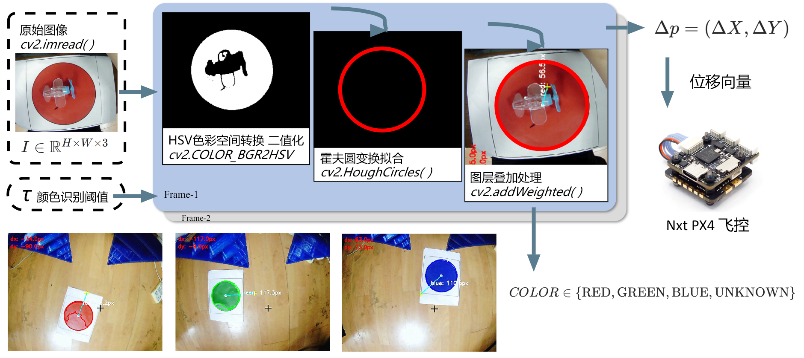
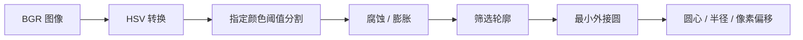

# 彩色标靶检测

我用 OpenCV 检测红、绿、蓝三种标靶，提取中心位置，再计算标靶中心与图像中心的偏移。处理画面中标出了目标轮廓、圆心和像素偏移。


*Fig. 1 红、绿、蓝三色标靶识别演示*

完整视频：[红色](../media/target-red.mp4) · [绿色](../media/target-green.mp4) · [蓝色](../media/target-blue.mp4)。

## 视觉处理方案



*Fig. 2 标靶颜色识别与位置偏移处理流程图*

方案先做颜色筛选，再用霍夫圆变换提取圆心，将结果叠加回原图，最后输出位置偏移。

流程图采用 `cv2.HoughCircles()`，桌面实验脚本采用轮廓筛选与 `cv2.minEnclosingCircle()`。OpenMV 实验脚本使用 LAB 阈值，图中的 OpenCV API 对应桌面或机载处理程序。

## OpenCV 桌面实验



*Fig. 3 基于颜色分割与轮廓的标靶检测流程*

桌面版按以下步骤处理图像：

1. 将 BGR 图像转换为 HSV，再按颜色阈值生成掩码。红色使用两段 H 范围合并掩码，绿色和蓝色各使用一组范围。
2. 先腐蚀、再膨胀，处理掩码中的碎点和边界。
3. 寻找外轮廓，选择最大的轮廓；多色版本增加了最小面积筛选。
4. 用最小外接圆提取中心和半径，再绘制目标中心、图像中心及两者连线。
5. 计算水平、垂直偏移和中心距离。

相关 API：[HSV 范围分割](https://docs.opencv.org/4.x/da/d97/tutorial_threshold_inRange.html)、[形态学处理](https://docs.opencv.org/4.x/d9/d61/tutorial_py_morphological_ops.html)、[轮廓与最小外接圆](https://docs.opencv.org/4.x/d3/dc0/group__imgproc__shape.html)。

## 坐标与输出

图像大小为 `W × H`，标靶圆心为 `(cx, cy)`，图像中心取 `(W // 2, H // 2)`。桌面脚本使用以下坐标约定：

```text
dx = cx - W // 2                 右侧为正
dy = H // 2 - cy                 上方为正
d  = sqrt(dx² + dy²)             单位：像素
```

`dx`、`dy` 和 `d` 都是像素量。换算成实际距离或投放位置，还需要相机参数、深度数据和坐标变换。

## ROS 红色检测节点

红色检测节点通过图像话题接收画面，按指令开启检测或切换阈值，再发布归一化中心坐标。

| 接口 | 脚本中的用途 |
| --- | --- |
| `/image_view/image_raw` | 订阅图像 |
| `if_eyes` | 接收检测开关，`red_open` 开启红色检测 |
| `up_low` | 在两组阈值之间切换 |
| `trust_my_eyes` | 发布字符串形式的 `x/W,y/H,red`，无目标时为 `None,None,red` |

ROS 版本输出归一化图像坐标，桌面版本输出像素偏移。

## 光照与背景的影响

颜色阈值受光照、曝光、反光和背景颜色影响。最大轮廓与最小外接圆能提取目标中心，但这套流程没有完整的圆形判别；画面中出现更大的同色物体时，也可能被当成标靶。
